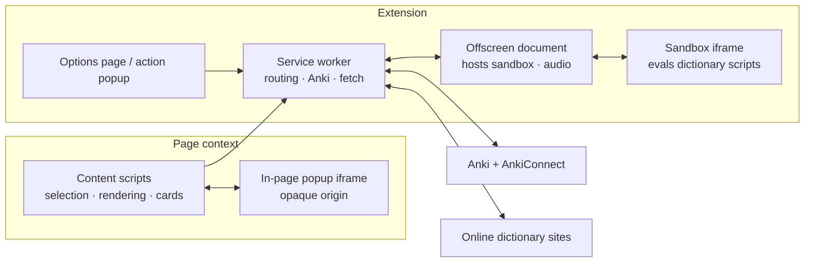
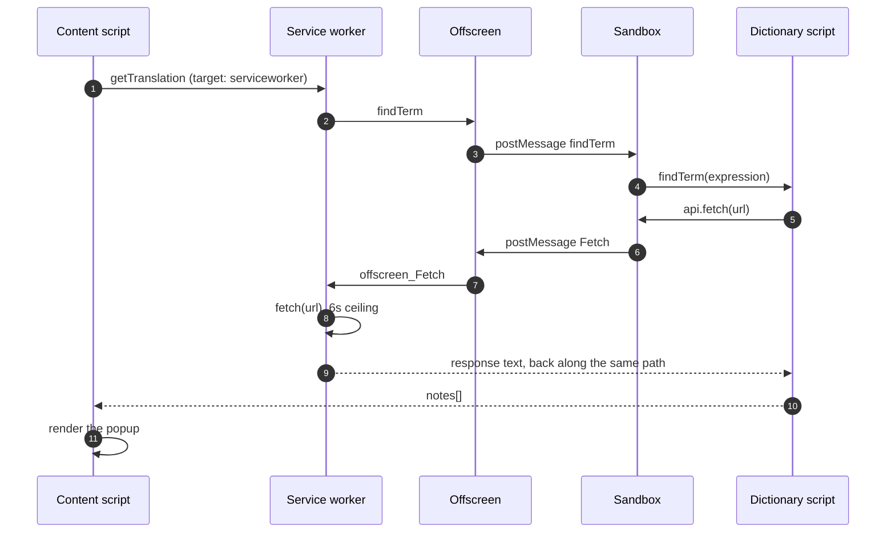
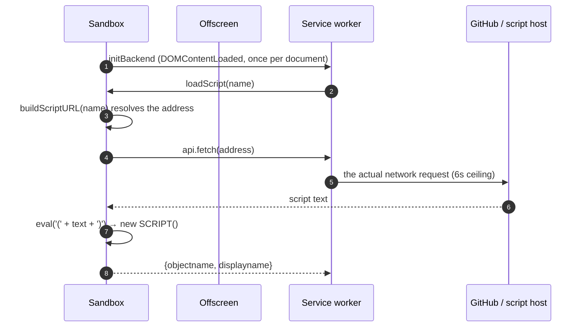

# Online Dictionary Helper (with Anki support)

English | [中文](README.zh.md)

## Introduction

Online Dictionary Helper (ODH) is a Chrome extension. Select a word or phrase on any web page — including PDFs inside the pdf.js viewer — and a popup with its definitions appears next to it. Definitions come from dictionary scripts: either the dictionaries shipped with the extension, or a script you write yourself to scrape any online dictionary.

With [Anki](https://apps.ankiweb.net/) and [AnkiConnect](https://github.com/FooSoft/anki-connect) installed, you can turn a selected definition plus the page sentence into a review card in one click.

Read the [background](docs/background.md) for why it exists.

## User guide

Installation, lookup, what each options-page section does, card creation and troubleshooting: see the [user guide](docs/user_guide_odh.md).

## Developer guides

| What you are doing | Read this |
| --- | --- |
| Changing the extension itself (environment, checks, layout, PRs) | [ODH developer guide](docs/dev_guide_odh.md) |
| Writing an external dictionary script | [Dictionary script guide](docs/dev_guide_uds.md) |
| Working with built-in dictionary data | [Built-in dictionary data format](docs/dev_guide_dict.md) |

Existing scripts live under `src/dict/`, covering various language pairs.

## Architecture

The extension runs in four mutually isolated environments, each able to do only what it can:

| Environment | Responsibility | Constraint |
| --- | --- | --- |
| **Content scripts** `src/fg/` | selection, popup rendering, click handling in the page | shares the DOM, but JavaScript globals are isolated |
| **Service worker** `src/bg/js/` | message routing, configuration, Anki requests, cross-origin fetch | no DOM, no `window`, no `Audio` |
| **Offscreen document** `src/bg/` | hosts the sandbox iframe, plays audio | only `chrome.runtime`; storage and tab work goes back to the worker |
| **Sandbox** `src/bg/sandbox/` | runs dictionary scripts | opaque origin with no access to any `chrome.*` API |

**Why it splits this way**: the worker is the only place that can issue cross-origin requests and the natural owner of state, but it has no DOM — hence the offscreen document for the iframe and `Audio`. The offscreen document in turn only gets `chrome.runtime`, so storage and tab work still route back to the worker. Dictionary scripts must be able to `eval()` (the script is text fetched at runtime) and extension pages may not — which is exactly why the sandbox needs an opaque origin.

## Messaging

Two message channels run side by side, with different protocols that must not be mixed:

| Channel | Between | Routing |
| --- | --- | --- |
| `chrome.runtime` messages | extension pages, content scripts, worker, offscreen | a `target` field on the request: `serviceworker` / `offscreen` / `frontend` |
| `window.postMessage` | content script ↔ in-page popup iframe; offscreen ↔ sandbox | its own action / params / callbackId protocol |

- On receiving a runtime message the worker checks `sender.id` and `target`, then maps to a handler using **browser-supplied sender information** (`sender.tab`, or the exact `sender.url`) — names like `frontend_getTranslation`, `options_optionsChanged`. The source is never read from the message body.
- Every cross-boundary reply is an envelope: `{ok: true, value}` on success, `{ok: false, error: {kind, message}}` on failure. Failures carry a classification (`network`, `timeout`, `handler-error`, …) and are never flattened into "no result".
- The default deadline for awaiting a reply is **8 seconds**; a timeout fails with the `timeout` kind and does not cancel the original request. A dictionary `fetch` has its own separate **6-second** ceiling inside the worker.

The full path of one lookup:

## Sandbox

Dictionary scripts come from this repository or from arbitrary URLs, and they must be able to `eval()`. Those three facts rule out running them in an ordinary extension page.

The manifest declares `src/bg/sandbox/sandbox.html` as a sandbox page. It runs in an **opaque origin** cut off from every extension API; the manifest declares no custom sandbox CSP, so the default policy permits `eval()`. Capability is exposed through a single `api` object — currently `fetch`, `deinflect`, `getBuiltin` and `locale`.

Loading a script is not "the worker fetches the text and hands it over" — it is a nested request originating in the sandbox itself:

What this buys: even a malicious script can only run in an origin that holds no extension API. Everything it can do must pass through those `api` methods, and behind them sits the worker's protocol allowlist (only `http`/`https`/the extension's own resources; link-local and cloud metadata endpoints refused).

## License

This project is MIT licensed (see [LICENSE](LICENSE)). The bundled third-party
library is listed in [THIRD_PARTY_LICENSES.md](THIRD_PARTY_LICENSES.md).
