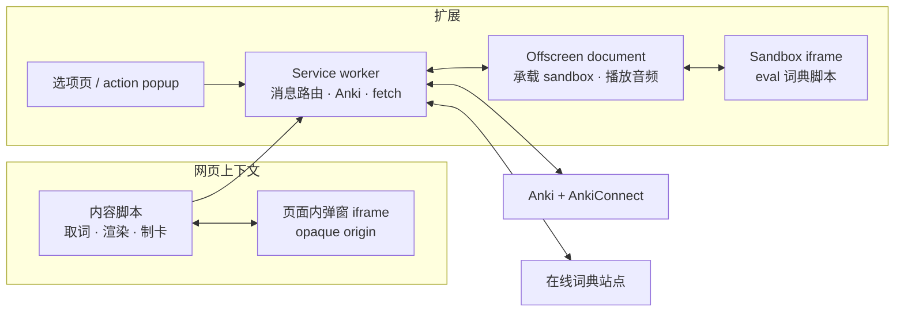
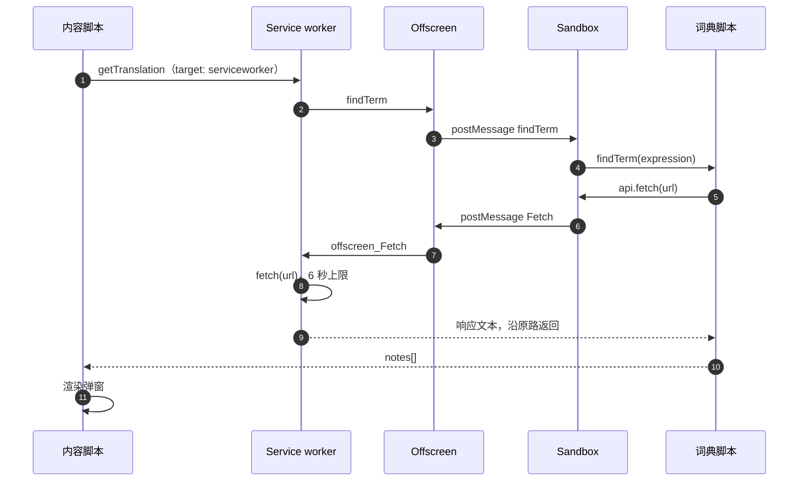
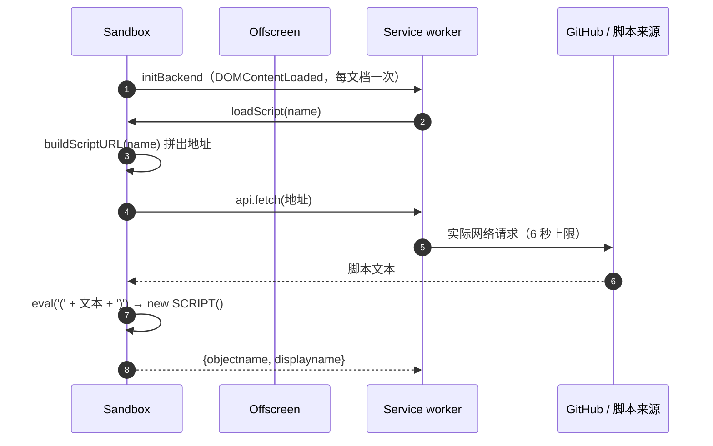

# 在线词典助手（含 Anki 制卡）

English | 中文

## 简介

在线词典助手（ODH）是一个 Chrome 扩展。在任意网页——包括 pdf.js 阅读器里的 PDF——上选中单词或短语，词旁会弹出释义窗口。释义来自词典脚本：可以用扩展自带的词典，也可以用你自己写的脚本从任意在线词典抓取。

装了 [Anki](https://apps.ankiweb.net/) 与 [AnkiConnect](https://github.com/FooSoft/anki-connect) 之后，可以把选中的释义连同页面原句一键做成复习卡片。

阅读[项目背景](docs/background.zh.md)了解它为什么存在。

## 架构

扩展运行在四个彼此隔离的环境里，每个环境只能做它能做的事：

| 环境 | 职责 | 限制 |
| --- | --- | --- |
| **内容脚本** `src/fg/` | 在网页里取词、渲染弹窗、接收点击 | 与页面共享 DOM，但 JavaScript 全局隔离 |
| **Service worker** `src/bg/js/` | 消息路由、配置、Anki 请求、跨域 fetch | 没有 DOM、没有 `window`、没有 `Audio` |
| **Offscreen document** `src/bg/` | 承载 sandbox iframe、播放音频 | 只能拿到 `chrome.runtime`，存储与 tab 操作由 worker 代做 |
| **Sandbox** `src/bg/sandbox/` | 运行词典脚本 | 独立 opaque origin，拿不到任何 `chrome.*` API |

**为什么必须这样拆**：worker 是唯一能发起跨域请求、也最适合持有状态的地方，但它没有 DOM——所以需要 offscreen 来承载 iframe 与 `Audio`；offscreen 又只能拿到 `chrome.runtime`，所以存储与 tab 仍要回到 worker。词典脚本必须能执行 `eval()`（脚本是运行时取回的文本），而扩展页面不允许——这正是不透明 origin 的 sandbox 存在的理由。

## 消息传递

扩展里跑着两套消息通道，协议不同，不能混用：

| 通道 | 用途 | 路由方式 |
| --- | --- | --- |
| `chrome.runtime` 消息 | 扩展页面、内容脚本、worker、offscreen 之间 | 请求里的 `target` 字段：`serviceworker` / `offscreen` / `frontend` |
| `window.postMessage` | 内容脚本 ↔ 网页内弹窗 iframe；offscreen ↔ sandbox | 自定的 action / params / callbackId 协议 |

- worker 收到 runtime 消息后先校验 `sender.id` 与 `target`，再按**浏览器提供的来源**（`sender.tab` 或精确的 `sender.url`）映射到 handler，形如 `frontend_getTranslation`、`options_optionsChanged`。来源不从消息体里读。
- 跨边界回执统一用信封：成功是 `{ok: true, value}`，失败是 `{ok: false, error: {kind, message}}`。失败带分类（`network`、`timeout`、`handler-error` 等），不会被压平成「没有结果」。
- 等待回执的默认期限是 **8 秒**，超时以 `timeout` 分类失败，不取消原请求。词典 `fetch` 在 worker 侧另有独立的 **6 秒**上限。

一次划词查词的完整链路：

## 沙盒

词典脚本来自代码仓库，也可能来自任意 URL，还要能执行 `eval()`。这三件事决定了它不能跑在扩展的普通页面里。

manifest 把 `src/bg/sandbox/sandbox.html` 声明为 sandbox 页面。它运行在**独立的 opaque origin**，不能调用任何扩展 API；manifest 没有自定义 sandbox CSP，所以默认策略允许 `eval()`。能力通过一个 `api` 对象暴露，目前提供 `fetch`、`deinflect`、`getBuiltin` 与 `locale`。

脚本的加载不是「worker 取文本再发给 sandbox」，而是 sandbox 自己的嵌套请求：

这套设计的收益：脚本即使有恶意代码，也只能在拿不到任何扩展 API 的 origin 里运行；它唯一能做的事情都必须经过 `api` 的这些方法，而方法背后是 worker 的协议白名单（仅 `http`/`https`/扩展自身资源，拒绝 link-local 与云 metadata 端点）。

## 开发指南

| 你在做什么 | 看哪份 |
| --- | --- |
| 改扩展本身（环境、检查、目录、PR） | [ODH 开发指南](docs/dev_guide_odh.zh.md) |
| 写外部词典脚本 | [词典脚本开发指南](docs/dev_guide_uds.zh.md) |
| 做内置词典数据 | [内置词典数据格式](docs/dev_guide_dict.zh.md) |

现有脚本都在 `src/dict/` 下，覆盖多种语言组合。

## 使用说明

安装、划词、选项页各栏的作用、制卡与常见问题，见[使用说明](docs/user_guide_odh.zh.md)。

## 许可证

本项目采用 MIT 许可证，详见 [LICENSE](LICENSE)。随附的第三方库声明见
[THIRD_PARTY_LICENSES.md](THIRD_PARTY_LICENSES.md)。
